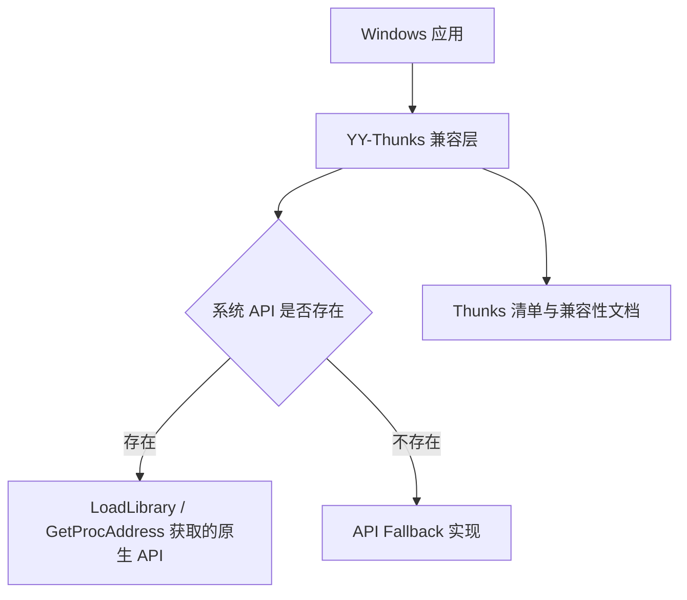
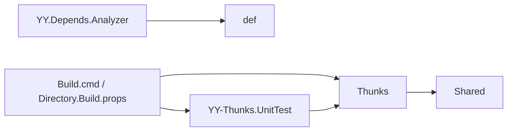

# YY-Thunks 架构总览

> 置信度说明：🔍 自动探测 | 🟡 规划中 | ✅ 已确认
> 最后更新：2026-09-18 18:13:53 +08:00

## 1. 项目概述

- 项目简介：为 Windows 应用提供缺失系统 API 的动态加载与兼容性 Fallback，帮助应用运行在较旧版本的 Windows 上。
- 核心能力：通过动态加载 API；当目标系统不存在 API 时提供兼容实现或安全的占位行为。
- 目标平台与兼容性：Windows 原生应用；工程配置覆盖 x86、x64，并以可配置的 Windows 最低版本作为兼容性基线。🔍 自动探测

## 2. 技术栈与工具链

| 类别 | 选型 | 版本 | 说明 | 置信度 |
| --- | --- | --- | --- | --- |
| 语言 | C++ | C++17（单元测试工程当前配置） | Thunks 代码需要兼容较早的编译器与运行环境 | 🔍 |
| 构建系统 | MSBuild / Visual Studio | Visual Studio 解决方案格式 12.00 | 解决方案位于 `src/YY_Thunks.sln` | 🔍 |
| 目标架构 | x86、x64 | Debug/Release | 解决方案配置为 `Debug|x86`、`Debug|x64`、`Release|x86`、`Release|x64` | 🔍 |
| 测试工程 | `YY-Thunks.UnitTest` | 原生 C++ 单元测试 | 位于 `src/YY-Thunks.UnitTest` | 🔍 |
| 辅助工具 | `MinimumRequiredVersionHelper` | 原生 C++ 工程 | 用于最低系统版本相关处理 | 🔍 |
| 分析工具 | `YY.Depends.Analyzer` | 原生 C++ 工程 | 用于依赖/API 信息分析 | 🔍 |
| 主要依赖 | Windows SDK / Visual C++ 工具链 | 由工程环境提供 | 头文件与系统库由 Visual Studio/Windows SDK 提供 | 🔍 |

## 3. 系统架构

项目采用以 API 兼容层为核心的原生 C++ 组织方式。业务应用通过链接 YY-Thunks 的目标文件或 NuGet 集成获得兼容能力；兼容层优先尝试调用系统原生 API，不存在时进入对应 Fallback。

关键文字总结：YY-Thunks 在应用与 Windows API 之间提供动态解析和按 API 划分的兼容实现，测试工程和分析工具围绕该兼容层提供验证与辅助能力。

## 4. 模块设计

| 模块 | 路径 | 职责 | 置信度 |
| --- | --- | --- | --- |
| Thunks 兼容实现 | `src/Thunks` | 按系统 DLL/API 提供动态解析和 Fallback 实现；例如 `user32.hpp` | 🔍 |
| 共享基础设施 | `src/Shared` | 提供多个 Thunks 模块复用的基础设施 | 🔍 |
| WinRT Fallback 实现 | `src/Thunks/WinRT` | 承载 `RoGetActivationFactory` 等 WinRT 相关 fallback 的具体实现，按 RuntimeClass 或相关 WinRT 能力拆分文件 | ✅ |
| 原生单元测试 | `src/YY-Thunks.UnitTest` | 验证兼容层行为和回归场景 | 🔍 |
| 最低版本辅助工具 | `src/MinimumRequiredVersionHelper` | 辅助处理最低系统版本相关信息 | 🔍 |
| 依赖分析器 | `src/YY.Depends.Analyzer` | 分析 Windows API 与依赖信息 | 🔍 |
| 构建/定义输入 | `src/def`、`src/Directory.Build.props`、`src/Build.cmd` | 提供 API 定义、共享构建属性和构建脚本 | 🔍 |
| 兼容性产物 | `src/objs` | 保存或生成面向不同目标平台的对象文件产物 | 🔍 |

模块间依赖关系：

## 5. 非功能性约束

| 类别 | 约束 | 置信度 |
| --- | --- | --- |
| 兼容性 | Thunks 实现需要面向较旧 Windows 系统和较早 C++ 编译器保持可用；实现代码避免依赖现代标准库设施 | 🔍 |
| 平台 | 至少维护 x86 与 x64 构建配置 | 🔍 |
| 性能 | 原生 API 存在时优先直接转发，减少不必要的兼容层开销 | 🔍 |
| 可靠性 | 对不具备对应系统能力的旧系统，Fallback 应提供明确的成功、失败或占位语义 | 🔍 |
| 可追溯性 | 新增 Windows API Fallback 需要同步维护 `ThunksList.md` | 🔍 |

## 6. 关键设计决策（ADR 摘要）

| 编号 | 决策 | 原因 | 影响范围 | 置信度 |
| --- | --- | --- | --- | --- |
| ADR-001 | 优先动态解析原生 API，不存在时执行 Fallback | 避免旧系统因导入表缺少 API 而无法启动，同时在新系统保留原生行为 | `src/Thunks` 全部 API 兼容模块 | 🔍 |
| ADR-002 | 按 Windows DLL 和 API 划分 Thunks 实现 | 与系统 API 边界对应，便于维护、定位和生成兼容性产物 | `src/Thunks` | 🔍 |
| ADR-003 | `RoGetActivationFactory` 的特定 RuntimeClass fallback 统一放入 `src/Thunks/WinRT/`，NuGet 配置层只负责暴露开关与构建期符号保留 | 将运行时实现与 NuGet 配置职责分离，避免 WinRT fallback 逻辑散落到非 WinRT 模块或配置层 | `src/Thunks/WinRT`、`NuGet/build` | ✅ |
| ADR-004 | 为支撑某个 Thunk，允许拦截"目标系统已存在"的通用 API（如 `CreateFileW`），但拦截仅允许做旁路处理，不得改变被拦截 API 的语义 | 部分 Thunk 需要跨进程/跨实例交换信息，而系统未提供可用通道；项目已有 `CloseHandle` / `DuplicateHandle` 先例 | `src/Thunks`、链接方性能 | ✅ |
| ADR-005 | 已被 thunk 化的公共 API 名在 `src/Thunks` 内部**可直接 `::ApiName()` 调用**，无需 `GetProcAddress` 动态解析 | `__DEFINE_THUNK` 的声明（`__DEFINE_THUNK_EXTERN_PREFIX`）与实现（`__DEFINE_THUNK_IMP_PREFIX`）共用同一套 `#if` 守卫，两种状态互补：`Target < 该 API 引入版本` 时本项目提供 fallback 实现，`Target >= 该 API 引入版本` 时最低系统已保证该 API 存在。因此不存在"thunk 不参与编译且系统也没有该导出"的真空区间。**禁止**用 `GetProcAddress` 自行解析：它只能看到 DLL 的真实导出，看不到本项目的 fallback 实现，会误判为"系统不支持" | `src/Thunks` 全部跨文件调用的 thunk | ✅ |
| ADR-006 | 进程级状态（如 CpuSet 的进程默认）存入 `YY_ThunksSharedData`，作为同进程内多 DLL / 静态库实例的唯一事实源 | 该结构通过 `CreateFileMappingW` + PID 命名共享，同一进程内所有 YY-Thunks 实例看到同一份数据；避免各模块维护本地副本导致状态不一致 | `src/Thunks/YY_Thunks.h`、需要进程级状态的 thunk | ✅ |
| ADR-007 | 需要在"新线程"上生效的进程级状态，通过 `.CRT$XLY` 段注册的 TLS 回调在 `DLL_THREAD_ATTACH` 时应用 | `DLL_THREAD_ATTACH` 是唯一能可靠捕获"新线程已创建、用户代码未执行"的时机；模块存在 TLS 段时 `DisableThreadLibraryCalls` 实际无效，回调一定生效。注意：CRT 可能对 `DllMain` 执行线程补发一次伪 `THREAD_ATTACH`，需用一次性线程 ID 标记识别 | `src/Thunks`、需要按线程生效的进程级状态 | ✅ |
| ADR-008 | 需要原子整体读写的多字段记录，**把需要一起生效的字段按自然对齐排在同一原子单元内**，不靠手工位打包；跨位数无法安全解释的共享记录**直接拒绝**，不做半吊子兼容 | ① 位打包是复杂度而非正确性来源：字段顺序选对（如 `KAFFINITY Mask` 在前、`WORD Group` 在后）后，x86 得 8 字节、x64 得 16 字节，一次 CAS 即可整体替换，无需打包/解包函数。② 共享结构体的字段偏移随指针宽度变化，32 位进程打开 64 位进程映射时用成员地址会算错位置 —— 但这类跨位数访问本身就无法等价表达（`KAFFINITY` 位宽、记录宽度、原子操作宽度都不同），因此直接报 `ERROR_CALL_NOT_IMPLEMENTED`，不引入固定偏移、双阶段读或序号字段等复杂度。对齐要求用 `static_assert(offsetof % (2 * sizeof(void*)) == 0)` 兜住，不改结构体布局。跨进程辅助函数一律直接接收调用方已有的进程句柄，不再按 PID 反推重开 | 需要原子多字段状态的 thunk、跨进程共享的记录 | ✅ |

## 7. 跨模块契约与公共接口

- API 解析契约：每个 Fallback 优先调用对应的 `try_get_<ApiName>()` 解析结果；解析成功时转发到系统 API，解析失败时执行模块定义的兼容行为。🔍
- 工程契约：`src/YY_Thunks.sln` 统一组织单元测试、最低版本辅助工具和依赖分析器工程。🔍
- 清单契约：`ThunksList.md` 记录可用的 API Fallback 及其行为摘要。🔍
- WinRT 兼容契约：`src/Thunks/api-ms-win-core-winrt.hpp` 中的 `RoGetActivationFactory`、`RoActivateInstance` 等 API 由 WinRT/COM fallback 提供兼容行为，当前已观察到 `RoGetActivationFactory` 仅对有限接口提供本地工厂返回。🔍
- WinRT 实现边界契约：新增 `RoGetActivationFactory` RuntimeClass fallback 时，优先将具体实现放在 `src/Thunks/WinRT/` 同级目录体系下，由 WinRT 入口层统一映射；NuGet 侧仅负责构建期启用条件与符号保留。✅
- WinRT NuGet 配置能力：项目的 NuGet 集成同时包含 native 属性页扩展与 native/.NET 两套 targets，可为特定 WinRT fallback 提供配置开关，并按目标最低平台版本决定是否生效。✅
- Thunk 拦截契约：为支撑某个 Thunk 而拦截"已存在"的通用 API 时，拦截实现必须满足四项约束——（1）优先转发原生 API；（2）仅在其调用成功后做旁路处理；（3）旁路处理失败不得改变被拦截 API 的返回值与 `GetLastError`；（4）内部调用一律使用 `try_get_*` 原始指针以避免递归。✅
- 单 TU 包含契约：所有 Thunk 头文件由 `src/Thunks/YY_Thunks_List.hpp` 聚合进同一翻译单元编译；该文件由 `YY-Thunks.UnitTest.vcxproj` 的 MSBuild 目标（`Build_YY_Thunks_List_hpp`）从 `ClInclude` 条目自动生成，顺序与登记顺序一致。头文件之间可直接跨文件调用，但被调用方必须排在调用方之前，或在使用点之前的公共头文件（如 `YY_Thunks.h`）中声明。🔍
- 管道族跨文件调用契约：为支撑 `GetNamedPipeClientProcessId` 协作，`api-ms-win-core-file.hpp` 的 `CreateFileA/W` 拦截调用管道族登记入口；因 file.hpp 在生成清单中排前，`RegisterPipeClientProcessId` / `IsLocalNamedPipePathW` / `IsLocalNamedPipePathA` 在 `YY_Thunks.h` 提前声明、在 `api-ms-win-core-namedpipe.hpp` 的 `YY_Thunks_Implemented` 块内定义；拦截实现遵循"仅旁路处理"约束（ADR-004）。✅
- 跨 thunk 调用契约：`src/Thunks` 内调用已 thunk 化的公共 API 名，一律直接 `::ApiName()`，不引入 `GetProcAddress` 动态解析。依据 `__DEFINE_THUNK` 的互补覆盖（详见 ADR-005）：被调用方守卫区间必然覆盖调用方所需。典型正例：`GetLogicalProcessorInformationEx` / `GetThreadGroupAffinity` / `SetThreadGroupAffinity` 的守卫均为 `< __WindowsNT6_1`，Windows 10 引入的 CpuSet API 守卫为 `< __WindowsNT10_10240`；`YY_Thunks_Target` 为 `6_1`/`6_2`/`6_3` 时前者不参与编译，但此时最低系统即 Win7/2008 R2，该 API 由系统真实提供，直接调用有效。✅
- 共享状态契约：需要跨 DLL / 跨静态库实例共享的进程级状态，一律存入 `YY_ThunksSharedData` 映射（ADR-006）。该映射按 PID 命名，同一进程内所有实例看到同一份数据。**但结构体本身只能在「同位数」下按成员访问**：其字段偏移随指针宽度变化，32 位进程打开 64 位进程的映射时用成员地址会算错位置。因此**跨位数的共享访问一律拒绝**（返回 `ERROR_CALL_NOT_IMPLEMENTED`），而不是引入固定偏移做半吊子兼容（ADR-008）。同时，记录的原子读写必须覆盖整条记录（x86 用 `Value64` 做 CAS64、x64 用 CAS128），静态回退实例须 16 字节对齐，否则 `cmpxchg16b` 触发 #GP。✅
- TLS 回调契约：需要"随新线程自动生效"的进程级状态，用 `.CRT$XLY` 段注册 `PIMAGE_TLS_CALLBACK`，并**必须同时 `__foreinclude(_tls_used)`**，否则链接器会裁掉整个 TLS 段导致回调不触发（`api-ms-win-core-fibers.hpp` 已有先例）。回调内只允许调用无 loader lock 依赖的系统 API，禁止 `LoadLibrary` 与堆分配。✅
- 加载器伪 `THREAD_ATTACH` 契约：`DLL_PROCESS_ATTACH` 后，**CRT 运行库**可能对**同一线程**补发一次 `DLL_THREAD_ATTACH`（这是 CRT 的内部行为，不是加载器行为，是否发生取决于 CRT 版本与静态/动态链接方式）。需要在 `THREAD_ATTACH` 里区分"新线程"与"CRT 补发"时，用「`PROCESS_ATTACH` 时记录的线程 ID + 一次性标记」判定；该补发不受 `DisableThreadLibraryCalls` 影响。✅

## 8. 已知技术债务与限制

| 编号 | 问题 | 影响 | 计划 | 置信度 |
| --- | --- | --- | --- | --- |
| TD-001 | 部分旧系统 Fallback 只能提供占位成功或固定失败语义，无法模拟不存在的硬件/系统能力 | 调用方只能获得兼容返回值，不能获得真实系统能力 | 在 API 级文档和测试中明确行为边界 | 🔍 |
| TD-002 | 完整构建依赖正确配置的 Windows SDK/WDK 头文件环境 | 缺少系统头文件时无法构建测试工程 | 在开发环境中固定并验证所需 SDK/WDK 组件 | 🔍 |
| TD-003 | WinRT fallback 覆盖面仍有限；当前 `RoGetActivationFactory` 仅观察到 `IUIViewSettings` / `IUIViewSettingsInterop` 特判 | 新增 WinRT 兼容需求需要扩展类工厂映射、错误语义与回归测试 | 在具体 feature 中补充设计、实现与测试 | 🔍 |
| TD-004 | 命名管道对端 PID 协作机制不提供伪造防护（同会话进程可改写槽位池） | 返回的 PID 仅可作为诊断线索，不可用于安全授权判断 | 在 `ThunksList.md` 与 API 文档中显式声明，不尝试缓解 | ✅ |
| TD-005 | 命名管道协作仅覆盖 `CreateFileW` / `CreateFileA` / `CreateNamedPipeW` / `CreateNamedPipeA`；`CallNamedPipe`、`TransactNamedPipe`、匿名管道与远程管道不参与 | 这些路径下对端 PID 查询降级为 `ERROR_NOT_SUPPORTED` | 在 `ThunksList.md` 中列为已知限制；`CallNamedPipe` 的后续实现方向已记录在 Specs §5.7，按实际需求评估排期 | ✅ |
| TD-006 | `internal::BitsCount`（`YY_Thunks.cpp`）在 MSVC 下直接使用 `__popcnt` / `__popcnt64` 内建，未做 CPUID 分派。这两个内建编译为 `POPCNT` 指令（SSE4.2，Nehalem 2008 起），在更老的 CPU 上会 `#UD` 崩溃 | 若在早于 Nehalem 的 x86/x64 CPU 上运行本项目的 fallback，且该路径调用 `BitsCount`，会直接崩溃。属**既有问题**，非 CpuSet feature 引入：`api-ms-win-core-sysinfo.hpp` 在本 feature 之前就已调用 `BitsCount` | **用户已确认后续统一处理**（2026-11-11）：「必需使用 `internal::BitsCount`，后面我会统一处理下 `internal::BitsCount` 的兼容性问题，先记录问题」。CpuSet feature 按用户裁决直接使用 `internal::BitsCount`，不自带本地实现；该 TD 关闭后自动受益。建议方案：CPUID 探测 SSE4.2 → 是则用内建、否则用 SWAR 循环 | 🟡 |
| TD-007 | CpuSet 系列在旧系统上用**线程/进程亲和性**模拟 CpuSet 选择，而两者是正交维度 | 调用方若同时使用亲和性 API 与 CpuSet API，行为会互相干扰；且 CpuSet 的「软亲和」语义无法用硬约束的亲和性完整表达 | 已在内建 `__WarningMessage__`、`ThunksList.md` 与 Specs §12.2 显式声明 | ✅ |
| TD-008 | CpuSet fallback 的 Id 是**本地确定性编码**（`组号 × 位序宽度 + 组内位序`），而原生 CpuSet Id 是不透明标识 | 同一 CpuSet 在不同进程/不同机器上的 Id 数值不一致；跨进程传递 Id 不可靠 | 已声明为已知差异（Specs §12.2）。对本机内使用无影响 | ✅ |
| TD-009 | `SetThreadGroupAffinity` 跨进程写入只需 `THREAD_SET_INFORMATION`，不认 `THREAD_SET_LIMITED_INFORMATION`（实测返回 `ERROR_ACCESS_DENIED(5)`）；而原生 `SetThreadSelectedCpuSets` 用 LIMITED 权限即可 | 用最小权限句柄的调用方在 fallback 下会拿到 `5`，原生能成功 | 已在 `ThunksList.md` 与 Specs §12.2 第 3 条声明权限门槛差异 | ✅ |
| TD-010 | `GetSystemCpuSetInformation` fallback 的 `CoreIndex` 给出紧凑序号，`LastLevelCacheIndex` / `NumaNodeIndex` / `SchedulingClass` / `AllocationTag` 恒 0，`AllFlags` 恒 0 | 调用方若依赖这些字段做缓存/NUMA 拓扑分析，会得到退化结果 | 已在 `ThunksList.md` 与 Specs §3.8 / §3.9 声明。Fallback 不枚举缓存与 NUMA 拓扑 | ✅ |
| TD-011 | CpuSet fallback 受 `SetThreadGroupAffinity` 单组约束：进程默认只保存「一个组号 + 一个掩码」；Id 集合跨组时只取第一个 Id 所属组，其它组丢弃 | 多处理器组机器上，非首个组的处理器选择不会生效；原生完整支持多组 | 已在 Specs §3.1 / §12.2 第 4 条声明。取舍理由：记录多组只有当前线程所属组会生效，其它组是死数据 | ✅ |
| TD-012 | CpuSet 系列的 TLS 回调会强制生成 TLS 段，导致 `DisableThreadLibraryCalls` 失效 | 宿主调用该 API 后，本模块仍会收到 `DLL_THREAD_ATTACH`。对 CpuSet 方案是**必要条件**，但对宿主而言是意外的行为变化 | 已按项目既有行为记录（`api-ms-win-core-libraryloader.hpp` 已声明 Win8.1+ 该 API 恒返回 `TRUE`，DLL 有 TLS 时 `THREAD_ATTACH` 仍发送）。已在 Specs §12.2 第 16 条声明 | ✅ |
| TD-013 | 一次性 `THREAD_ATTACH` 标记在「加载器不补发伪 ATTACH」的系统上，会让每个模块的首个真实新线程被误跳过，不继承进程默认 | 影响面：每模块最多 1 个线程；静态库与 XP 场景不存在。相比「标记永不清零 + 线程 ID 复用」的持续误判，这是严格更优的取舍 | 已在 Specs §3.6「代价与取舍」与 §12.2 第 17 条声明；V-11 要求先计数确认伪 ATTACH 是否真实存在，再做断言 | ✅ |
| TD-014 | 跨位数（x86↔x64）的 CpuSet 进程默认访问不支持，返回 `ERROR_CALL_NOT_IMPLEMENTED(120)` | 32 位进程的 `KAFFINITY` 只有 32 位，无法表示 64 位进程的 64 位掩码；记录宽度（8 vs 16 字节）与原子操作宽度也不同。原生可跨位数工作 | 已在 Specs §3.1 与 §12.2 声明。读写都拒绝；实现方式是「只尝试本进程位宽对应的架构族」（64 位试 `_amd64`/`_arm64`，32 位试 `_x86`/`_arm`），跨位数天然打不开对方映射，不需要 `IsWow64Process` 探测（ADR-008）；同架构跨进程完全可用 | ✅ |
| TD-015 | CpuSet fallback 按组号缓存处理器数量（`g_ProcessorCountCache[64]`），运行期**热添加处理器后不刷新** | 新处理器的 CpuSet Id 在该进程内被判为 `ERROR_CPU_SET_INVALID(813)`，直到进程重启；`GetSystemCpuSetInformation` 不受影响（它直接走 GLPIEx） | 已在 Specs §4.2 与 §12.2 第 4b 条声明。取舍原因：处理器拓扑在常规场景下固定，用「重启后生效」换掉每次调用一次系统调用；旧系统本来完全没有 CpuSet 支持 | ✅ |
